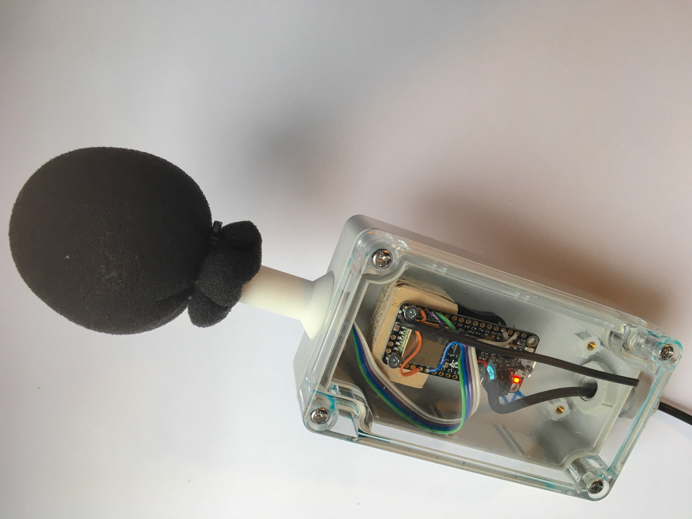
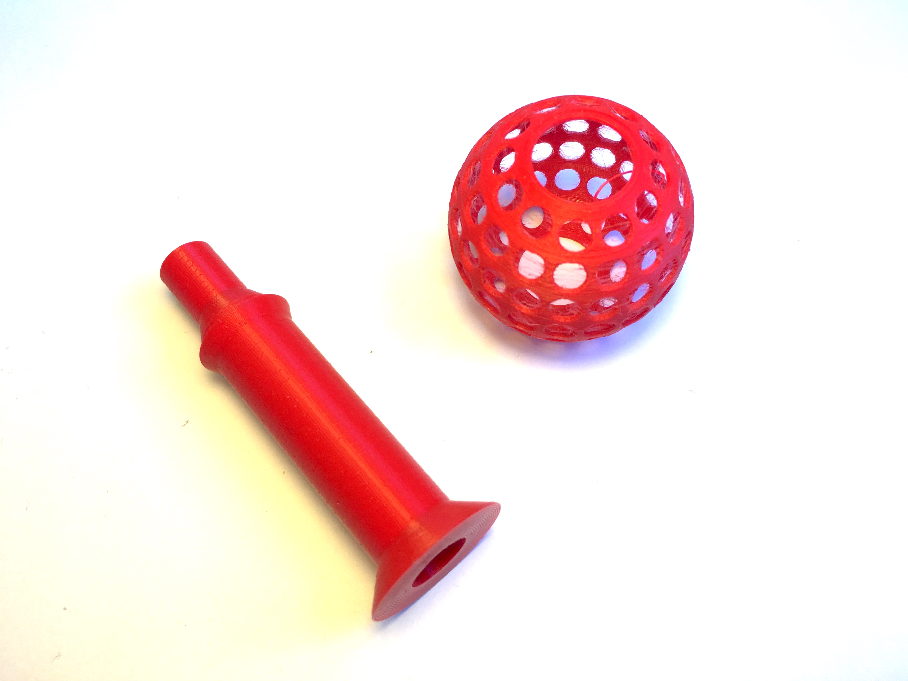
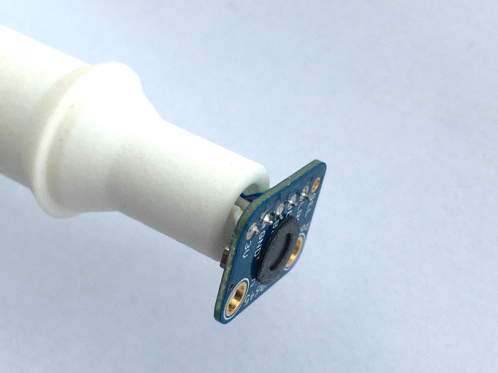

## Voorburg Sounds Kit — Feather LoRaWAN

This publication is the Feather LoRaWAN development, based on the [Amsterdam Sounds Kit](https://gitlab.waag.org/lodewijk/amsterdam-sounds-kit). It uses an **Adafruit Feather RP2040 RFM95** with an **SPH0645 I2S microphone** and an external BAT-to-A0 resistor divider. The RFM95 provides a real EU868 LoRaWAN radio, so the device can operate from a battery through a Things Indoor gateway without Wi-Fi. For the Wi-Fi-based Pico 2 W implementation, see the companion `voorburg-sounds-kit-Pico2Wifi` publication.

The RP2040 dual-core division follows the stable Pico architecture: **core 1 owns I2S, DMA audio capture, and SLM/DSP statistics; core 0 owns LMIC, LoRaWAN receive windows, payload creation, USB logging, and LittleFS persistence**. Measurements stay on a fixed five-minute schedule and are handed over atomically. Flash commits request a bounded core-1 audio pause and resume only after the write completes. A core-1 heartbeat and watchdog supervision recover from a stalled audio path.

Compared with the Amsterdam base, this development adds the RP2040 RFM95 pin map and bundled EU868 LMIC 5.0.1, ABP session/counter persistence, LoRaWAN DeviceTime timestamps, optional battery ADC bytes, a TTN uplink formatter, and the dual-core/flash-safety lifecycle. These changes separate radio transport from audio work and avoid USB logging backpressure; the published runtime logging is limited to startup, UTC synchronization, payload hex, errors, and essential transmit completion.

The published settings contain placeholders only. Create the Feather as a separate ABP end device in TTN, open its **Overview → Activation information / Session information**, and copy its DevAddr, NwkSKey, and AppSKey into a private local `LoraSettings.h`. Never commit these values. The Pico must use a different ABP identity and frame-counter stream.

* [Amsterdam Sounds kit](#amsterdam-sounds-kit)
* [Electronic components assembly](#electronic-components-assembly)
* [Code installation](#code-installation)
* [Configuration](#configuration)
* [TTN setup](#ttn-setup)
* [Tools](#tools)
* [Enclosure](#enclosure)
* [Code documentation](#code-documentation)
* [Limitations / known issues](#limitations--known-issues)
* [Considerations](#considerations)
* [Parts list](#parts-list)
* [References](#references)

## Amsterdam Sounds kit  
**Open source (hardware) sound level meter for the internet of things.**



However the code is intended for bringing a TTN sound level meter in the air. The code can easily be adapted to make a stand alone offline device by stripping out the LoRa part of de the code.

## Electronic components assembly

* SPH0645LM4H-B on breakout board (Adafruit)
* Adafruit Feather RP2040 RFM95 LoRa (supported by this port)
* Adafruit Feather M0 RFM95 LoRa (legacy pin mapping remains available)

Connect the microphone (SPH0645LM4H) to the selected board as shown below. The original Feather M0 wiring remains supported; for the Feather RP2040 RFM use D10, D11, and D12 for I2S. On the RP2040, D10 is BCLK, D11 is LRCLK, and D12 is microphone data (DIN). The sketch configures these pins in `SLMSettings.h`.

### Feather RP2040 RFM wiring

| SPH0645 microphone | Feather RP2040 RFM |
| --- | --- |
| 3V | 3V |
| GND | GND |
| BCLK | D10 / GPIO10 |
| LRCL / WS | D11 / GPIO11 |
| DOUT | D12 / GPIO12 |
| SEL | GND (left channel) or 3V (right channel) |

The sketch currently reads the right channel. Strap the microphone's SEL pin to 3V for that channel, or change `channel` in `SLM.h` to `0` if SEL is strapped to GND.

The Feather RP2040 RFM has the radio wired on-board; no radio jumpers are needed. The RP2040 LMIC map uses CS GPIO16, reset GPIO17, and DIO0/1/2 GPIO21/22/23.

### Legacy Feather M0 wiring

```
+---------+     +----------------+
| SPH0645 |     | Feather M0     |  
+---------+     +----------------+  
| 3V      | <-> | 3V             |
| GND     | <-> | GND            |
| BCLK    | <-> | 1 / I2SCK / TX |
| DOUT    | <-> | 9 / I2SD0      |
| LRCL    | <-> | 0 / I2SF0 / RX |
| SEL     |     |                |
+---------+     | IO1            | <-+
                |                |   |
                | 6              | <-+
                | Ant.           | <------------------------
                +----------------+
```

**N.B.**
* On a Feather M0 RFM95, connect pin 6 to IO1 as required by its LMIC DIO1 mapping. The RP2040 Feather has its radio DIO pins wired internally.
* A solid wire can be use as an antenna. [Look up](https://learn.adafruit.com/adafruit-feather-m0-radio-with-lora-radio-module/antenna-options) which length is needed for which LoRa frequency.

## Code installation

#### Feather RP2040 RFM board support

For the Feather RP2040 RFM, install the **Raspberry Pi Pico/RP2040/RP2350** board package by Earle F. Philhower using its board manager URL: `https://github.com/earlephilhower/arduino-pico/releases/download/global/package_rp2040_index.json`. Select **Adafruit Feather RP2040 RFM** in the Arduino IDE. The RP2040 core provides the I2S implementation used by this port.

The legacy Feather M0 build still uses the Adafruit SAMD board package.

#### MCCI LoRaWAN LMIC library

The Feather sketch bundles **MCCI LoRaWAN LMIC 5.0.1** under `Arduino/VoorburgSoundsKit/src/FeatherLMIC`, including its EU868/SX1276 configuration. Arduino IDE compiles this copy directly; installing or updating a global LMIC library does not change the Feather build. Version 6.0.1 does not load ABP session keys into the crypto backend and must not be used for this firmware. The sketch checks its LMIC version and verifies the loaded ABP keys before transmitting.

#### VoorburgSoundsKit

* Download the code and open [**VoorburgSoundsKit.ino**](Arduino/VoorburgSoundsKit/VoorburgSoundsKit.ino) in the  Arduino IDE.

## Configuration

#### General settings

* *SEND_AFTER*  
Defines at which rate the device sends updates to The Things Network. Keep in mind that there is a limited data rate for the TTN (see [maximum duty cycle](https://www.thethingsnetwork.org/docs/lorawan/duty-cycle.html#maximum-duty-cycle)). The devices sends a summary over the specified period (see [limitations](#limitations--known-issues)).
* *USB_LOGGING*
Set this to `1` in `LoraSettings.h` to enable USB Serial diagnostics, or leave it at `0` for silent operation. Normal logging prints startup, UTC synchronization, one `PAYLOAD_HEX=` line per five-minute measurement, and errors. Microphone checksum/capture diagnostics are removed from the measurement loop. The nonblocking USB queue uses 1 KiB instead of 8 KiB. Optional radio event logging is controlled by `USB_RADIO_LOGGING` in `FeatherSettings.h`. Open the Arduino IDE Serial Monitor at 115200 baud. The sketch waits up to five seconds for the monitor, then continues if it is not connected.

The LoRaWAN code currently uses ABP, so there is no OTAA join step. The red user LED is on only during an application-payload transmission cycle, including its receive windows. It stays off while measuring and during automatic MAC-only replies; the separate charging LED is controlled by the board hardware. With optional radio logging enabled, `EV_TXSTART` and `EV_TXCOMPLETE` report radio transmission progress. Uplinks are unconfirmed, so transmit completion does not prove that TTN received the sample.

Snippet from [*LoraSettings.h*](Arduino/VoorburgSoundsKit/LoraSettings.h)

```c
#define USB_LOGGING 1
```

#### LoRa settings

This build uses a separate Feather ABP end device. The published files contain only placeholder identity values. The sketch rejects an address mismatch at compile time and verifies the loaded session address, NetID and keys before sending. The DevEUI callback uses LMIC little-endian byte order. AppEUI and the unused OTAA key callbacks explicitly return zeros because this is ABP. Session keys remain in a private local `LoraSettings.h` and must differ from the Pico’s keys.

To compare the Feather's keys with the current TTN session, run
`python3 Tools/check_feather_ttn_session.py` in an interactive Terminal. Copy the
network and application session keys from your Feather end device into its
hidden prompts. The checker reads the local `LoraSettings.h` and reports only
whether each key matches. It does not contact TTN, print or save the entered keys,
change credentials, or alter frame counters.

Snippet from [*LoraSettings.h*](Arduino/VoorburgSoundsKit/LoraSettings.h)

```c
static const PROGMEM u1_t NWKSKEY[16] = {0x00, 0x00, 0x00, 0x00, 0x00, 0x00, 0x00, 0x00, 0x00, 0x00, 0x00, 0x00, 0x00, 0x00, 0x00, 0x00 };
static const u1_t PROGMEM APPSKEY[16] = {0x00, 0x00, 0x00, 0x00, 0x00, 0x00, 0x00, 0x00, 0x00, 0x00, 0x00, 0x00, 0x00, 0x00, 0x00, 0x00 };
static const u4_t DEVADDR = 0x00000000;
```

* *NWKSKEY*  
16 byte **Network Session Key** to be copied from device overview in TTN console.

* *APPSKEY*  
16 byte **App Session Key** to be copied from device overview in TTN console.

* *DEVADDR*  
4 byte **Device Address** to be copied from device overview in TTN console.

#### SLM settings

Snippet from [*SLMSettings.h*](Arduino/VoorburgSoundsKit/SLMSettings.h)

```c
// Current mode
#define SLM_MODE SLM_MODE_DEBUG
```

* *SLM_MODE*  
Defines if and how the device outputs to the serial port, allowed values:
 * *SLM_MODE_NORMAL*  
 The SLM part of the code does not output at all. Use when deploying the device to stand-alone situation.
 * *SLM_MODE_STREAM_AUDIO*  
 The SLM streams the raw audio data from the microphone to serial port converting the 18 bit samples to 32 bit. This allows for capturing the audio to disk or listening to it to make sure it is OK (see [Tools](#tools)).
 * *SLM_MODE_STREAM_FFT*  
 The SLM outputs the raw ouput of the FFT to the serial port. Can be used in combination with the [*SpectrumPlotter*](Tools/SpectrumPlotter/SpectrumPlotter.pde) Processing tool. Note, conversion from fixed point numbers to float is done in Processing.
 * *SLM_MODE_OUTPUT*  
 The SLM outputs live dBA levels in a binary format. Intended to use with [*SPLDisplay*](Tools/SpectrumPlotter/SPLDisplay.pde) Processing tool.
 * *SLM_MODE_DEBUG*  
 The SLM writes live dBA levels in readable format to the serial port.
 * *SLM_MODE_PROFILE*  
 The SLM outputs the amount of time it consumes for doing the audio analysis.


* *Other settings*  
These settings are probably good to go. They allow you to tweak how the audio is analysed. Current settings make the device capture audio at 48000Hz and do a FFT analysis over 1024 samples of audio at a rate of 32 times per second. Changing these settings could lead to performance or memory issues. For example, longer FFT requires more processing time and longer buffers. Secondly the  scaling table for correcting the frequency response of the microphone and doing dBA weighting is precalculated for a specific FFT size. Changing this would require precalculating a new table ([*EQ.h*](Arduino/VoorburgSoundsKit/EQ.h)).

#### Acoustic calibration compared with the Feather M0

The RP2040 Feather preserves the original Amsterdam Sounds Kit M0's acoustic calculation basis and nominal microphone calibration. A source comparison on October 10, 2026 against the original M0 version at commit `4ab2076` confirmed:

- The same **48 kHz sampling, 1,024-sample FFT, and 32 analyses per second**.
- Identical **A-weighting and microphone frequency-response correction tables** in `EQ.h`.
- The same Hann normalization, fixed-point scaling, and **120 dB reference offset**.
- The same calculations for mean, minimum, maximum, population standard deviation, and energy-averaged measurement-period Leq.
- `EQ.h`, `Stats.h`, `RunningAvg.h`, `Util.h`, the weighted-energy/statistics calculation block, and Hann normalization are byte-for-byte unchanged from the M0 baseline.

Sample capture is adapted to RP2040 PIO/DMA, with the same intended 32-bit word/top-18-bit input scale and no added gain correction. FFT initialization and buffer placement changed for efficiency. **SLM and CMSIS-DSP perform the acoustic calculations; LMIC carries the results over LoRaWAN.**

The same intended calibration applies when using the **SPH0645LM4H-B** microphone model for which the correction table was generated. The [Knowles datasheet](https://cdn-shop.adafruit.com/product-files/3421/i2S%20Datasheet.PDF) specifies nominal sensitivity of -26 dBFS at 94 dB SPL/1 kHz, with a -29 to -23 dBFS range (**±3 dB**). Individual microphone sensitivity and mounting can therefore affect measured levels and frequency response.

The software basis has been verified. This Feather's physical calibration and identical readings between the M0 and RP2040 units remain unmeasured; no measured per-device sensitivity offset has been added. A comparison with a calibrated M0 or reference sound-level meter under the same stable sound, or an acoustic calibrator, is needed to establish the unit's absolute accuracy and any correction offset.

#### LMIC library settings  

The Feather's network plan is fixed in `Arduino/VoorburgSoundsKit/src/FeatherLMIC/project_config/lmic_project_config.h`. Every LMIC source file reads this same project-local configuration. No compiler flags or edits to the Arduino libraries folder are required.

```c
#define CFG_eu868 1
#define CFG_sx1276_radio 1
#define LMIC_DEBUG_LEVEL 0
```

Do not define `ARDUINO_SAMD_FEATHER_M0` for the RP2040 board. The sketch supplies its own board-specific LMIC pin map. The Adafruit Feather RP2040 RFM95's 900 MHz radio version supports both 868 MHz and 915 MHz; LMIC's selected region configures the operating channels. For EU868, define `CFG_eu868` and use an antenna tuned for 868 MHz (about 8.2 cm for a quarter-wave wire). If using a different RFM95 module or board, check its supported band and match the antenna to it.

## TTN setup

In order to be able to send data to The Things Network you have to make an account, [register](https://www.thethingsnetwork.org/docs/applications/add.html) an *application* and [add](https://www.thethingsnetwork.org/docs/devices/registration.html) *devices* to that application.
The application is your sandbox within TTN that manages all the devices registered to the application. N.B. currently the Arduino code only supports ABP devices, no OTAA yet.

#### Application setings

Apart from having to register individual devices nothing much has to be done here, except for setting the payload format. The sensor sends each frame of data in particular format to save bandwidth. The format at the sending end has to match the format at the receiving end.

**Payload format**

The Feather sends five acoustic values on FPort 1, followed by UTC and/or battery data only when available. Install [Tools/feather_ttn_uplink_decoder.js](Tools/feather_ttn_uplink_decoder.js) as a **custom JavaScript uplink formatter on the Feather end device**, then save it. It supports all four layouts:

| Length | Acoustic bytes 0–4 | UTC Unix seconds (little-endian) | Raw battery ADC (little-endian) |
| --- | --- | --- | --- |
| 5 | mean, min, max, stddev, leq | absent | absent |
| 7 | same | absent | bytes 5–6 |
| 9 | same | bytes 5–8 | absent |
| 11 | same | bytes 5–8 | bytes 9–10 |

Levels are encoded in 0.5 dBA steps and standard deviation in 0.125 dB steps. The formatter returns `mean`, `min`, `max`, `stddev`, `leq`, optional ISO UTC `at`, and optional `battery_adc` (0–4095). The timestamp is the measurement window’s end, not its delivery time. LoRaWAN DeviceTime supplies UTC; until synchronization succeeds there is no invented timestamp. The running UTC clock refreshes every six hours and starts unsynchronized after reboot.

Test the formatter with **FPort 1**, hexadecimal payload `463B982459`. It must return mean 35, min 29.5, max 76, stddev 4.5, leq 44.5. This is the real accepted FCnt1024 payload from the October 10 export. Formatting changes affect subsequent uplinks; they do not decode earlier stored events retroactively.

**Battery wiring and enabling**

The Feather RP2040 RFM95 has no built-in battery divider ([Adafruit documentation](https://learn.adafruit.com/feather-rp2040-rfm95/power-management)). Wiring is `BAT — 10 kΩ — A0/GPIO26 — 10 kΩ — GND`, with A0 connected to the midpoint. A0 is beside the microphone’s GND header connection and does not conflict with D10/D11/D12. Never connect BAT directly to A0. The external divider and battery were installed on October 10, and `FEATHER_BATTERY_ENABLED` is now `1` in `FeatherSettings.h`; compile and upload this update to activate sensing. Enabled builds send 7/11 bytes using a 12-bit, unconverted ADC reading; no battery percentage is estimated. Set the option to `0` if the divider is removed, returning to 5/9 bytes.

The battery-enabled build's first live measurement, FCnt1536 at `2026-10-10T11:56:14Z`, carried `463C9B2B5F810A` (7 bytes). TTN decoded the final bytes as `battery_adc: 2689` and emitted a matching application storage event. UTC synchronized from its downlink reply, so subsequent measurements should carry 11 bytes. The subsequent battery-only run, started at 14:23 Amsterdam, confirms the combined format: FCnt2050 at `2026-10-10T12:33:42Z` carried `403B5C1242A630CA6A7109` (11 bytes), with an embedded UTC matching the formatter, raw ADC 2417, and the user's formatter reporting `bat: 3.884`. The Indoor Gateway forwarded it to the application with USB disconnected, verifying standalone acoustic, UTC, and battery delivery.

The FFT instance is initialized once during startup. Unused per-sample checksum/min/max diagnostics, octave-band storage in the normal build, OTAA join code, and Class B beacon/ping code are excluded. The sound analysis, receive MAC commands, session verification and persistent counter protection remain enabled.

#### Measurement timing and transport

On the RP2040 Feather, the two RP2040 cores have separate jobs. Core 1 owns I2S, audio capture, and SLM/DSP calculation; core 0 services LMIC, receive windows, counters, and uplinks. Each measurement window is scheduled from the previous five-minute boundary, so the next window does not wait for the preceding radio transaction and publication times do not drift by the radio airtime. At a boundary, the completed statistics are copied to a small handoff record and the next window starts immediately.

Each handoff record gets one publication attempt. If LMIC is busy or rejects the packet, that measurement is dropped and the next five-minute window continues. A transmission timeout drops the outstanding publication, rebuilds the ABP session, and leaves the measurement scheduler running. The original M0 build keeps its single-core capture/transport fallback.

RP2040 flash persistence uses a Pico-style pause/acknowledge protocol: core 0 requests an audio pause, core 1 stops I2S and acknowledges, core 0 commits LittleFS state, and core 1 resumes. A core-1 heartbeat feeds watchdog supervision; a stalled audio core is allowed to reset the board for recovery rather than leaving a silent node. I2S remains active between measurement boundaries; only the SLM aggregates are reset.

#### Device settings

For each device added to the application the following settings have to be applied in the settings tab of the device:

* *Activation Method*: ABP. Use the Feather's own device address, network session key and application session key.
* *Frame counter checks*: enabled. The Feather persists its counters in LittleFS; select **8 MB flash with FS 64 KB** in Arduino IDE. It reserves blocks of 256 uplink counters, so a restart can skip unused counters while preserving monotonic values.
* *Receive windows*: on the first run without a receive-state file, use the actual initial settings seen in the TTN export: RX1 **1 second**, RX2 **SF12/BW125**, **869525000 Hz**. LMIC accepts TTN’s MAC commands to change these to RX1 **5 seconds** and RX2 **SF9/BW125** and saves/restores the negotiated settings in a separate LittleFS record. Do not erase this state or the counters when uploading.
* *MAC requests*: the five `NewChannelReq` commands configure channels 3–7, from 867.1 to 867.9 MHz. Receiving their downlink makes LMIC send the required MAC answers automatically. `ns.mac.command.unanswered` on the first updated-firmware uplink can refer to the previous firmware’s downlink; check a subsequent uplink before concluding reception still fails.

The October 10 v6 export confirms bidirectional operation: measurement FCnt1280 (`463BA9356E`) reached the application, downlink FCnt6 supplied UTC, the Feather synchronized its clock, and TTN accepted the automatic DevStatus answer at FCnt1281. No repeated new-channel requests or unanswered MAC commands appear in that export. FCnt1281 is a MAC-only event, so it correctly contains no acoustic application payload. `revspace` and `my-things-indoor-gateway` are receiving gateways for the same device. A subsequent export confirms nine-byte FCnt1282 and FCnt1283 application payloads exactly match the serial output, contain correct UTC `at` values, and have matching `as.packages.storage.up.store` events with no formatter errors or warnings. Acoustic measurements, LoRaWAN time, formatter output and application storage are verified end to end. The network DevStatus battery value 255 means unavailable and is distinct from the optional raw `battery_adc` field.

## Tools

The following tools can be found in the repository:

* [*precalculate_bin_scale_table*](Tools/PrecalculateBinScaleTable/precalculate_bin_scale_table.rb)  
A Ruby script that generates the table in [*EQ.h*](Arduino/VoorburgSoundsKit/EQ.h). It uses the frequency response of the microphone as input and a formula for calculating the frequency response of the dBA weighting. The microphone response was extracted from the datasheet.
* [*SPLDisplay*](Tools/SPLDisplay/SPLDisplay.pde)  
A Processing sketch that reads data from the sensor in order to display it nicely. ([SLM settings](#slm-settings)).
* [*SpectrumPlotter*](Tools/SPLDisplay/SPLDisplay.pde)  
A Processing sketch that reads raw FFT output data from the sensor in order to display it ([SLM settings](#slm-settings)).
* Capturing / listening device audio using unix/linux tools  
```bash
# capture audio to disk
cat /dev/cu.usbmodem14111 > audio.raw
# listen to audio (install mplayer command line utility)
cat /dev/cu.usbmodem14111 | mplayer -rawaudio rate=48000:channels=1:samplesize=4 -demuxer rawaudio -cache 1024 -
```
Put the device in [SLM_MODE_STREAM_AUDIO](#slm-settings).

## Enclosure

The bare components can be put in a custom housing for outdoor use.
Within the Amsterdam Sounds project a standard sized box (115mm x 65mm x 40mm) is used for containing the microprocessor and the antenna. The microphone placement is a little more difficult. It must be outside, but protected from the weather.

#### 3D printable microphone mount  
A custom 3D printable mount was designed for placing the microphone outside of the box and as a base for a standard sizes microphone windshield. The mount consists of *two parts* ([ball.stl](Enclosure/ball.stl), [base.stl](Enclosure/base.stl)) that can be printed with a 3D printer or ordered via an online printing service.



The mount can be glued onto the standard casing (PVC glue does work, drill a whole for the microphone cable first).

#### Acoustic vent  
In order to protect the microphone sound input hole an acoustic vent was used. These vents have a acoustically transparent ePTFE membrane and are used by smartphone manufacturers for the protection of microphones and speakers.
Sadly this is the one part that is not easily available if you just want to buy little amounts. However, they can be ordered via Alibaba for example. The vent is an adhesive that can be applied like a sticker directly on the SPH0645 breakout board.



#### Other parts

* A cable gland was used to lead the power cable into the box.
* A GoPro adapter was screwed into enclosure to make it compatible with GoPro mounting gear.

See complete [parts list](#parts-list)

## Code documentation

Code documentation is mainly written in the comments of the code.

## Limitations / known issues

#### Timing  
LoRa timing is critical. Currently the SLM cannot read en process audio and do the LoRa communication at the same time.

#### Data rate
LoRa has limited bandwidth for data transfer. Therefore the sensor only sends averages and statistics over periods of time (default minutely).

## Considerations

#### LoRaWAN

LoRaWAN was chosen as the network technology for this project since a lot of devices will be deployed in an area that is to big for WiFi coverage, but small enough for one TTN gateway. As such devices are only dependent of power when deployed.

#### Using FFT  
Using an FFT in the process of calculating dBA may seem inefficient. A time domain filter can also be used to do the A-weighting and microphone frequency response correction. However the CMSIS-DSP FFT implementation is quick enough. Also it saves us from having to use (or make) an extra filter designer tool. Besides scaling the FFT bins is an insightful way of correcting the frequency response.
Additionally, the DC-offset of microphone is quite big. Ignoring the first bin easily removes the whole effect that this would have on the sound level.
Finally a future version of this device might also send spectral information.

#### Statistics
Ideally the devices would send everything that it calculates. That would be about 32 dBA levels per second. At least with LoRa this is not doable. Therefore the device should send data at a much lower rate, at most once every minute. As such the device sends a summaries of measuring periods. Currently the summary contains the following statistical data.

* **min**  
The lowest LEQ recorded over the measuring period
* **mean**  
The mean LEQ over the measuring period
* **max**  
The highest LEQ recorded over the measuring period
* **stdev**  
The standard deviation over the mean LEQ.
* **N**  
The amount of frames analysed  over the measuring period.

*The standard deviation gives some insight in regularity of the sound level over the measuring period. Since the device sends only summaries a lot of spikes will be lost, however a high standard deviation is a hint for a period with a lot of variation in sound level.*

*Short-term levels use a power average over four analysed frames (32 frames/second divided by 8), nominally 1/8th of a second. The payload's `mean` averages those dB levels; `leq` averages frame power over the measurement period before conversion to dB. Both M0 and RP2040 analyze sampled FFT windows rather than every audio sample.*

#### Spectral information

Sound levels in dBA tell something about the noise situation, but not everything. The perception of two sounds with the same level can be totally different. One peak can be much more pervasive during a moment of silence. The Amsterdam Sounds project is about mapping the noise situation in the city of Amsterdam. It would give a lot of insight if we could not only measure the levels of sound but also define what the sound is and how it was experienced by people.
A first step to increasing the possibilities for increasing such insights might be to send spectral information from the device. It comes in handy that the device already does FFT analysis.

## Parts list

1. Microphone on breakout board  
https://www.adafruit.com/product/3421
1. Feather M0 with integrated LoRa radio for European frequency plan (EU863-870)  
https://www.adafruit.com/product/3178
1. Li Yue ⌀7x4mm, acoustic vent for sealing the microphone hole  
https://www.alibaba.com/product-detail/Black-Custom-Size-Waterproof-IP-67_62167248114.html
1. RND 455-00182, standard size enclosure (115mm x 65mm x 40mm)   
https://www.reichelt.nl/kunststof-behuizing-115-x-65-x-40-lichtgrijs-rnd-455-00182-p193396.html
1. Rycote 35/50 Reporter Mic Foam  
https://rycote.com/microphone-windshield-shock-mount/mic-foams-and-windjammers/
1. GoPro mount adapter  
https://www.uwcamera.nl/webshop/actioncam-accessoires/bekijk-alle-accessoires/detail/9647/14-male-schroefdraad-naar-gopro-adapter--tripod-adapter-omvormer.html

*Manufacturers website links where possible.*

## References

1. Project homepage  
https://amsterdamsounds.waag.org
1. Design of a Sound Level Meter, Douglas Lanman  
https://alumni.media.mit.edu/~dlanman/courses/decibel_meter.pdf  
1. CMSIS-DSP library reference  
https://arm-software.github.io/CMSIS_5/DSP/html/modules.html
1. Arduino IBM LMIC (LoRaWAN-MAC-in-C) library  
https://github.com/mcci-catena/arduino-lmic
1. Datasheet of digital MEMS microphone (SPH0645LM4H)  
https://cdn-shop.adafruit.com/product-files/3421/i2S+Datasheet.PDF
